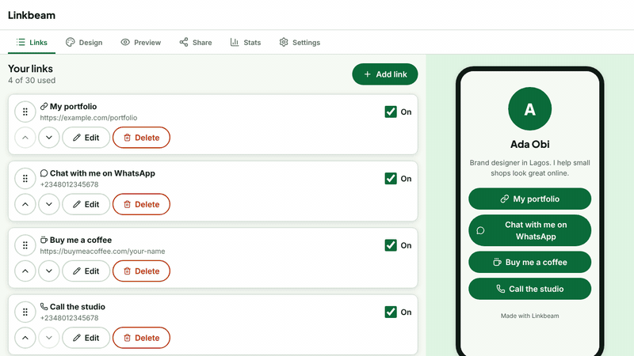
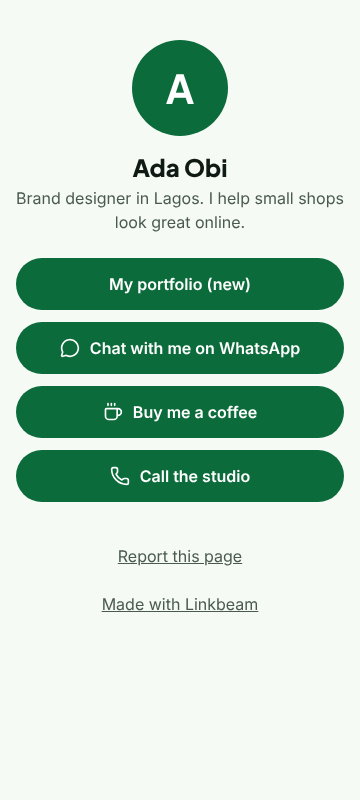
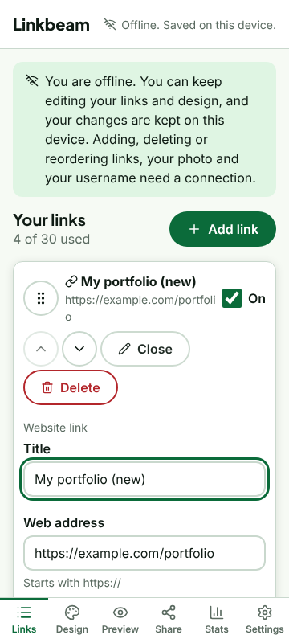

# Linkbeam

**One link. Everything you do. Free forever.**

A free, open-source link-in-bio page builder for creators, freelancers and small businesses. Built with Nigerian users in mind, and open for everyone. MIT licence.



| The public page | The dashboard, working offline |
|---|---|
|  |  |

> **Status: release candidate (`v1.0.0-rc.1`).** Everything is built and tested on a developer machine. It has **not** been deployed to a live site yet, and the owner steps in [docs/RELEASE_CHECKLIST.md](docs/RELEASE_CHECKLIST.md) come before `v1.0.0`. Read [docs/NOT_TESTED.md](docs/NOT_TESTED.md) to see what still needs a human check on a real phone, inbox and Cloudflare account. The deploy steps have been checked only on a local copy of Cloudflare's runtime.

## Why Linkbeam exists

Many people share one link in their bio on Instagram, WhatsApp, TikTok or X. The tools that offer this often charge for the features that small businesses need most, add their own ads, or load slowly on cheap phones and weak networks.

Linkbeam is free tools for creators everywhere. It is built with Nigerian users in mind: a WhatsApp button that works with international numbers, pages that load fast on slow connections, an app you can install and edit even when the signal drops, and costs kept so low that a person can run their own copy on free plans. It is open, so anyone can read it, change it, translate it and host it.

## What you get

- **A fast public page** at `/u/your-name`: about 78 KB in total, almost no JavaScript, Lighthouse 99 to 100 on a throttled phone. Works from 320 px wide, and has a dark theme (Ink).
- **Buttons that get work done:** website, WhatsApp (with an optional first message), Buy me a coffee (optional), phone call, email and map.
- **A dashboard** with autosave, drag-and-drop or button reordering, 8 themes, your own button colour, button shapes, font pairs and backgrounds, a live preview, link scheduling (show between two dates) and an avatar upload.
- **Share tools:** copy link, a QR code (PNG and SVG), and share buttons that load no third-party scripts.
- **Simple stats:** views and clicks per day. No visitor is tracked across sites.
- **Installable and offline-friendly:** add it to your phone's home screen. Edit your existing links, profile and design with no connection, and the changes are sent when you are back online.
- **Your data is yours:** download everything as JSON, or delete your account for good, in Settings.
- **Safe by design:** a full red-team pass (see [docs/SECURITY_REPORT.md](docs/SECURITY_REPORT.md)), strict content security policies, rate limits and bot checks.
- **No payments at all.** Linkbeam never handles money. The only support option is an optional link to your own Buy Me a Coffee page.

## Run it on your computer

You need Node 20 or newer (22 recommended), Git and pnpm.

```powershell
# Windows PowerShell
git clone https://github.com/YOUR-NAME/linkbeam.git
cd linkbeam
.\scripts\setup.ps1
```

```bash
# macOS or Linux
git clone https://github.com/YOUR-NAME/linkbeam.git
cd linkbeam
pnpm install && pnpm check
```

Then make the settings file and the local database once, and start the two apps in two terminals:

```powershell
# PowerShell
Copy-Item .env.example apps\api\.dev.vars
cd apps\api; pnpm exec wrangler d1 migrations apply linkbeam --local; cd ..\..
pnpm dev:api     # terminal 1  (http://127.0.0.1:8787/api/v1/health)
pnpm dev:web     # terminal 2  (http://localhost:4321)
```

```bash
# macOS or Linux
cp .env.example apps/api/.dev.vars
(cd apps/api && pnpm exec wrangler d1 migrations apply linkbeam --local)
pnpm dev:api     # terminal 1
pnpm dev:web     # terminal 2
```

Open http://localhost:4321. In local development, sign-in links are **printed in the API terminal** instead of emailed. If you call the API with a tool such as curl, add `-H "Origin: http://localhost:4321"`.

## Put it on the internet for free

Follow [docs/SELF_HOSTING.md](docs/SELF_HOSTING.md). In short, you need a free Cloudflare account and a free Brevo account (no credit card for either), and the whole site runs as one Cloudflare Worker:

```powershell
pnpm exec wrangler login
pnpm exec wrangler d1 create linkbeam          # paste the id into apps\api\wrangler.deploy.toml
pnpm build
cd apps\api
pnpm exec wrangler d1 migrations apply linkbeam --remote -c wrangler.deploy.toml
pnpm exec wrangler deploy -c wrangler.deploy.toml
```

The guide covers the secrets, the bot check, sign-in email, backup and restore, and how to handle reports. Please also read the note on the free request limit (B-027 in [docs/BACKLOG.md](docs/BACKLOG.md)).

## Configuration

| Name | Where | Secret? | What it does |
|---|---|---|---|
| `APP_URL` | `apps/api/wrangler.deploy.toml` (`.dev.vars` locally) | No | The site's address. Must match the address in the browser. |
| `MAIL_MODE` | same | No | `brevo` on a live site. `console` (prints links) only on your own computer. |
| `BREVO_SENDER_EMAIL` | same | No | The verified address sign-in emails come from. |
| `BREVO_API_KEY` | `wrangler secret put` | **Yes** | Sends email through Brevo. |
| `TURNSTILE_SECRET` | `wrangler secret put` | **Yes** | Checks the bot check. Without it, sign-ups are refused. |
| `IP_HASH_SECRET` | `wrangler secret put` | **Yes** | Hashes visitor addresses in the security log. |
| `GOOGLE_CLIENT_ID` / `_SECRET`, `GITHUB_CLIENT_ID` / `_SECRET` | `wrangler secret put` | **Yes** | Optional Google and GitHub sign-in. |
| `PUBLIC_TURNSTILE_SITE_KEY` | `apps/web/.env` before `pnpm build` | No | Shows the bot check. |
| `PUBLIC_SITE_URL`, `PUBLIC_REPO_URL`, `PUBLIC_CONTACT_EMAIL` | `apps/web/.env` before `pnpm build` | No | Page links, social cards and the legal pages. |

Never put secrets in a file you commit, in an issue, or in a chat.

## Commands

| Command | What it does |
|---|---|
| `pnpm check` | Types, lint, unit tests and build |
| `pnpm typecheck` / `pnpm lint` / `pnpm test` / `pnpm build` | Each step on its own |
| `pnpm e2e` | Browser tests against a real API and site on your computer. Needs Chromium |
| `pnpm lighthouse` | Lighthouse (mobile, throttled) of the public page and website pages. Fails below 95 |
| `node scripts/licenses.mjs` | Checks the licence of every dependency |
| `node scripts/smoke.mjs https://your-site` | Read-only smoke test of a deployed site you own |

For the browser tests, run `pnpm exec playwright install chromium` once, or set `CHROMIUM_PATH` to a Chromium or Chrome you already have. Stop `pnpm dev` first (the tests use ports 8787 and 4321).

## Layout

```
apps/web         Astro website (Preact islands), the installable app
apps/api         Hono API and public pages, for Cloudflare Workers
packages/shared  Validation (Zod), brand tokens, shared rules and text
migrations       SQL migrations for D1
tests/e2e        Browser tests (Playwright), accessibility and Lighthouse
docs             Decisions, threat model, security report, evidence
scripts          Setup, icons, licence check, red-team helpers
.github          CI, issue and pull request templates, Dependabot
```

## FAQ

**Is it really free?** The code is MIT and everything it needs has a free plan with no card: Cloudflare Workers, D1 and Turnstile, and Brevo for email. Free plans have limits, listed in [docs/FREE_TIER_LIMITS.md](docs/FREE_TIER_LIMITS.md). A very busy site may outgrow them.

**Can people pay me through it?** No. Linkbeam has no payment features on purpose. You can add your own links, and an optional Buy Me a Coffee button.

**Do you track my visitors?** No ads and no tracking scripts. The public page counts views and clicks per day, without cookies and without storing visitor addresses in your stats. See the Privacy page.

**Does it work offline?** The installed dashboard opens offline and lets you edit things that already exist. Adding, deleting and reordering links, your photo and your username need a connection. See [D-064](docs/DECISIONS.md).

**Is it safe to use?** It has had a careful security pass, with the findings and gaps written down in [docs/SECURITY_REPORT.md](docs/SECURITY_REPORT.md). It has **not** had an independent human review. Get one before you serve many real users.

**Can I translate it?** Yes. See [docs/TRANSLATING.md](docs/TRANSLATING.md). Only the visitor-facing text is in the translation file so far (B-032).

**Are the Terms and Privacy pages legal advice?** No. They are plain-English templates for you to edit and have checked.

**Can I use the name and logo?** The code is yours to use. The name and logo have simple rules in [docs/BRAND.md](docs/BRAND.md).

**I found a security problem.** Please report it privately. See [SECURITY.md](SECURITY.md).

## Docs

- [Self-hosting and backups](docs/SELF_HOSTING.md)
- [Release checklist](docs/RELEASE_CHECKLIST.md)
- [What has not been tested](docs/NOT_TESTED.md)
- [Security report](docs/SECURITY_REPORT.md), [threat model](docs/THREAT_MODEL.md) and [security policy](SECURITY.md)
- [Decisions](docs/DECISIONS.md) and [backlog](docs/BACKLOG.md)
- [API reference (OpenAPI)](docs/openapi.yaml)
- [Free-tier limits](docs/FREE_TIER_LIMITS.md)
- [Brand and trademark](docs/BRAND.md)
- [Translating](docs/TRANSLATING.md)
- [Third-party licences](docs/THIRD_PARTY_LICENSES.md)
- [Changelog](CHANGELOG.md)

## Contributing

Please read [CONTRIBUTING.md](CONTRIBUTING.md) and the [Code of Conduct](CODE_OF_CONDUCT.md). Good first issues include translations, component tests and real-phone checks.

## Licence

[MIT](LICENSE). Copyright (c) 2026 Nwali Grant Chukwudi. Third-party licences are listed in [docs/THIRD_PARTY_LICENSES.md](docs/THIRD_PARTY_LICENSES.md).
